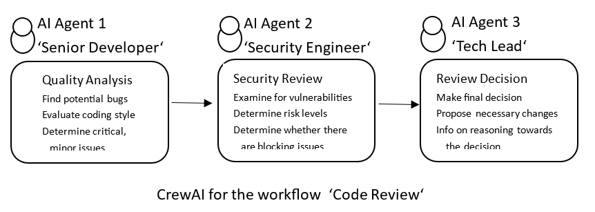

## AI Multi-Agentic Workflow to Use in CI/CD Pipeline for Evaluation of Pull Request Code Changes ##

  

**Objective**

This CrewAI system automates the pull request code review workflow for
software development pipelines. It systematically evaluates code changes
to detect quality issues, potential bugs, and maintainability concerns.
It performs security analyses using web tools to identify
vulnerabilities and assess risk levels against Open Worldwide
Application Security Project (OWASP) standards. It streamlines the
review process by combining code quality metrics and threat evaluations
into a cohesive pipeline. It makes independent decisions to
automatically approve changes, request specific fixes, or escalate to
human reviewers.

  

**Structure of the Code**

The code structure follows a **Sequential** process (as opposed to
parallel or hierarchical models), where tasks execute in a strict linear
order down a predefined pipeline. The system is built using three
specialized agents and corresponding tasks, as illustrated in the
workflow diagram below:

- **Senior Developer** (Role: Senior Developer; Goal: Evaluate code
  quality, bugs, and maintainability) performs the **Quality Analysis**
  task to flag critical versus minor code issues.

- **Security Engineer** (Role: Security Engineer; Goal: Evaluate
  vulnerabilities and risk levels) performs the **Security Review** task
  using web tools to check security compliance.

- **Tech Lead** (Role: Tech Lead; Goal: Determine approval paths and
  final recommendations) performs the **Review Decision** task by
  synthesizing context and outputs from both preceding tasks.

- **Important Note:** The architecture relies on task context linking,
  ensuring the final decision task has full visibility into both quality
  and security findings before making an approval or escalation
  judgment.

- **LLM:** the model is 'gpt-4o-mini'

  

**The Result of the Work of this CrewAI**

The input to the system is a pull request code diff containing backend
user authentication and database logic. The system processes this code
through sequential quality and security evaluations conducted by the
specialized agents. The output is a comprehensive decision report
detailing critical code issues, security vulnerabilities, risk levels,
and a final approval or escalation recommendation.

  

**How to Run this Multi-Agent AI System - CrewAI**

To run this multi-agent system, simply open your Jupyter Notebook and
execute each code cell sequentially from top to bottom. The code file
is: MultiAgentTool_CrewAI_JupiterNotebookCells.py. The system
automatically loads the pull request code 'diff' from an example file
named code_changes.txt. You will configure the tools, set up the
specialized agents, define their individual tasks, and assemble them
into a Crew. To start the workflow, run the final kickoff cell, which
feeds the code changes into the automated review pipeline. Once
execution finishes, the complete findings and review decisions are
stored within the result object. You can easily read the final
recommendations and approval status by inspecting the output of the
third and final task. Specifically, the final decision report can be
cleanly viewed by executing the cell that displays
Markdown(result.tasks_output\[2\].raw).

  

**Characteristics of this System, Related to Generic Aspects of
Multi-Agent AI Workflows**

When deploying multi-agent AI systems in enterprise environments,
companies typically evaluate solutions against five core requirements,
independently of their existing technology stack. Below is how this
automated code review system addresses these generic requirements:

- **Interoperability:** The ability to use different providers and avoid
  vendor lock-in.

> The system integrates with external web services and search engines
> via specialized CrewAI tools (SerperDevTool pointing to the Open
> Worldwide Application Security Project and ScrapeWebsiteTool), while
> connecting to external language model APIs (OpenAI) through
> environment configurations.

- **Observability:** The ability to clearly understand what your agent
  has done and *why* it did it that way, allowing full traceability.

> Enabled through verbose=True settings across agents and the crew,
> allowing detailed tracking of agent thought processes and execution
> steps, complemented by result serialization (dill) and granular task
> output inspection (result.tasks_output).

- **Governance:** The ability to track data access, authentication, and
  authorization systems to ensure compliance with internal standards.

> Implemented through rigid role-based specializations (Senior
> Developer, Security Engineer, Tech Lead) and a strict sequential
> pipeline that enforces a clear chain of review responsibilities and
> structural accountability.

- **Evaluations:** How to measure performance and quality over time,
  guaranteeing that agents function correctly without breaking as they
  evolve.

> Structured using strict expected output formats (e.g., specific JSON
> keys for quality and security findings) and utility functions
> (get_dict_keys) alongside unit test modules to verify that task
> outputs meet required formatting and logical criteria.

- **Guardrails:** Mechanisms to ensure more reliable, repeatable
  outcomes.

> Enforced via bounded agent roles, mandatory contextual dependencies
> between tasks, and strict JSON schema expectations for expected
> outputs, ensuring agents operate within defined parameters and do not
> bypass review stages.

  

**Trouble Shooting**

In case the code in Jupiter Notebook cells does not run, or you
encounter other difficulties, do the following:

Check that Python version is 3 or later.\
Check that you have started the cells in correct sequence - from top to
bottom.\
In case of other difficulties contact the vendor:
<ruben.ispiryan@yahoo.de>. Attach screenshots and diagnostic messages.
